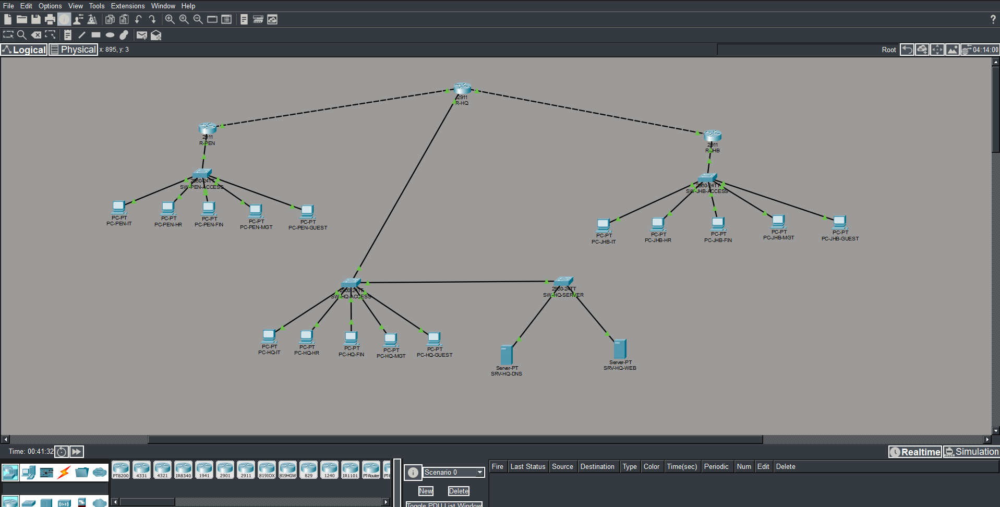

# Secure Multi-Site Enterprise Network

**Cisco Packet Tracer | Enterprise Networking & Network Security**

I built this three-site network to get hands-on practice with enterprise routing, network segmentation, shared services and device security. The scenario uses a fictional company, **Meridian Technologies Malaysia**, with its headquarters in Kuala Lumpur and branches in Penang and Johor Bahru.

The goal was to connect all three offices while keeping departmental traffic separated and allowing access to the services staff actually need.

*Final working topology in Cisco Packet Tracer.*

## Network at a glance

| | My setup |
|---|---|
| Locations | Kuala Lumpur (HQ), Penang, Johor Bahru |
| Devices | 3 Cisco 2911 routers, 4 Cisco 2960 switches, 15 PCs, 2 servers |
| Departments | IT, HR, Finance, Management, Guest |
| Routing | Router-on-a-stick and OSPF area 0 |
| Services | DHCP at each site; centralized DNS and intranet website at HQ |
| Security | Extended ACLs, SSHv2, sticky-MAC port security, unused-port shutdown |
| Software | Cisco Packet Tracer 9.0.0.0810 |

## What I built

- Set up separate VLANs and IP subnets for each department, with 802.1Q trunks and inter-VLAN routing.
- Connected the sites in a **hub-and-spoke topology**. Penang and Johor Bahru communicate through HQ using OSPF.
- Configured DHCP for client devices and centralized DNS and HTTP services for the corporate intranet.
- Applied ACLs to restrict guest and unwanted interdepartmental traffic while allowing required services.
- Secured remote device administration with SSHv2 and a management access policy restricted to HQ IT.
- Configured sticky-MAC port security on **17 active access ports** and disabled **82 unused ports** in a parking VLAN.

## Testing and results

I tested the network in Packet Tracer's Realtime and Simulation modes. These are some of the results I recorded:

| Test | Result | Evidence |
|---|---|---|
| Intranet access from Penang Finance and Johor HR | Both sites reached the HQ website by hostname | [Penang](evidence/phase7/T06_PEN_FIN_Intranet.png) · [Johor](evidence/phase7/T07_JHB_HR_Intranet.png) |
| Penang HR to Johor Finance | Ping blocked as intended | [Blocked traffic](evidence/phase7/T09_PEN_HR_to_JHB_FIN_Blocked.png) |
| Penang to Johor routing | Traceroute passed through HQ | [Traceroute](evidence/phase7/T16_PEN_to_JHB_Traceroute.png) |
| OSPF cost change | Route metric changed **3 → 52 → 3** and was restored | [CLI results](evidence/phase8/T17_OSPF_Cost_Evaluation.txt) |
| ICMP packet forwarding | Echo request and reply crossed the expected path | [Simulation](evidence/phase8/T18_ICMP_Simulation_EventList.png) |

I also checked SSH access restrictions, switch-port protection and unused-port shutdown. The [validation document](docs/04_Validation_and_Evidence.md) distinguishes tests with screenshots from results recorded during the project without a separate screenshot.

## Documentation

- [Logical network diagram](diagrams/Final_Topology.png) and [editable Graphviz source](diagrams/Final_Topology.dot)
- [Architecture and device connections](docs/01_Architecture.md)
- [IP addressing and VLANs](docs/02_IP_Addressing_and_VLANs.md)
- [Security controls](docs/03_Security_Controls.md)
- [Validation results and evidence](docs/04_Validation_and_Evidence.md)
- [Validation matrix](Validation_Matrix.xlsx)

## About the Packet Tracer file

I keep the original `.pkt` file private because it includes saved lab credentials and SSH key material. I can demonstrate the completed simulation privately; this repository provides the design, technical documentation and test evidence for public review.

This is an **educational network simulation**, not a production deployment. It does not include Internet connectivity, VPNs, a redundant WAN, or a dedicated firewall and Packet Tracer simulation times are not real-world network performance measurements.

**Project completed: November 2026.**
