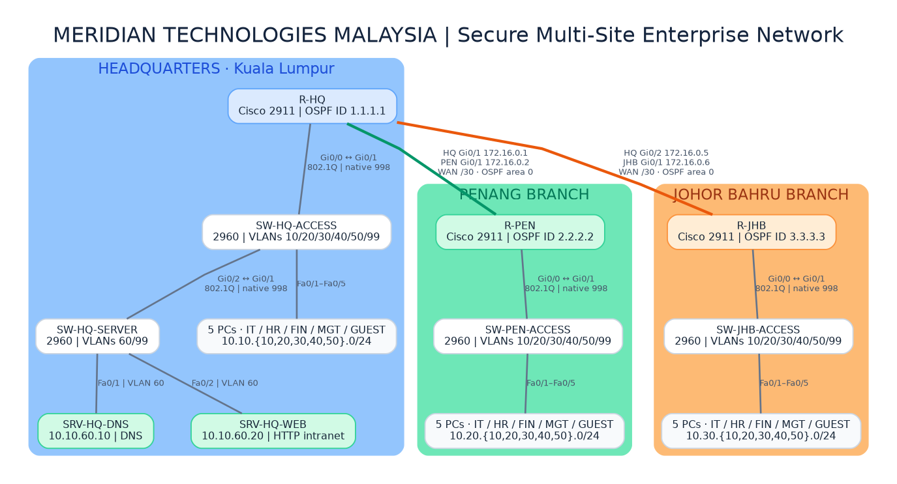

# Secure Multi-Site Enterprise Network

*A Cisco Packet Tracer project covering enterprise networking, routing and security.*

I built this project to practice designing and securing a network that connects multiple office locations. The scenario is based on a fictional company, **Meridian Technologies Malaysia**, with a headquarters in Kuala Lumpur and branches in Penang and Johor Bahru.

My aim was to get the different sites communicating through dynamic routing, provide shared services from Hq and restrict access between departments where it isn't needed.

**Tools:** Cisco Packet Tracer 9.0.0.0810 · Cisco 2911 routers · Cisco 2960-24TT-L switches

## Network overview

| Component | Setup |
|---|---|
| Locations | Kuala Lumpur (HQ), Penang, Johor Bahru |
| Devices | 3 routers, 4 switches, 15 PCs, 2 servers |
| Departments | IT, HR, Finance, Management, Guest |
| VLANs | 10–50 for departments, 60 for HQ servers, 99 for management |
| Routing | Router-on-a-stick and OSPF area 0 |
| Network services | DHCP at each site; DNS and intranet web server at HQ |
| Security | Extended ACLs, SSHv2, port security, and disabled unused ports |

The sites use a hub-and-spoke layout: Penang and Johor Bahru connect through the HQ router. Each department has its own VLAN and IP subnet, with inter-VLAN traffic routed through the local router.

## What I implemented

- **VLANs and routing:** Set up VLANs, 802.1Q trunk links and router subinterfaces for communication between approved networks.
- **OSPF:** Configured routing across all three sites, with neighbor relationships on the WAN links.
- **DHCP, DNS and web services:** Configured DHCP for client PCs and a central DNS server and intranet website at HQ.
- **Access control:** Used router ACLs to restrict guest access and unwanted traffic between departments while allowing required services.
- **Secure management:** Enabled SSHv2 and limited administrative login access to the HQ IT network.
- **Switch security:** Configured sticky-MAC port security on 17 PC/server access ports and moved 82 unused ports to a separate VLAN before shutting them down.

## Testing and results

I tested the network in both Realtime and Simulation modes rather than relying only on the saved configurations. Some of the checks included:

- Opening the HQ intranet by its DNS name from allowed PCs at the branch offices.
- Confirming that Penang HR could not ping a protected Finance PC in Johor Bahru.
- Checking that authorized SSH access worked and unauthorized management connections were blocked.
- Verifying OSPF neighbors and tracing traffic from Penang to Johor Bahru through HQ.
- Changing the OSPF cost on a Penang interface, observing the route metric change from **3 to 52**, then restoring it to **3**.
- Following an ICMP request and reply between Penang IT and the HQ DNS server in Simulation mode.

The test matrix and screenshots are included in this repository. Some earlier test results are recorded in the matrix without a separate screenshot.

## Documentation

| File | What's inside |
|---|---|
| [Network diagram](diagrams/Final_Topology.png) | Overview of the three-site layout |
| [Editable diagram source](diagrams/Final_Topology.dot) | Graphviz topology file |
| [Architecture](docs/01_Architecture.md) | Devices, interfaces and connections |
| [IP addresses and VLANs](docs/02_IP_Addressing_and_VLANs.md) | Addressing and VLAN plan |
| [Security controls](docs/03_Security_Controls.md) | ACLs, management access, and switch security |
| [Validation and evidence](docs/04_Validation_and_Evidence.md) | Tests and supporting screenshots |
| [Validation matrix](Validation_Matrix.xlsx) | Test cases and outcomes |
| [Phase 7 screenshots](evidence/phase7) | Connectivity and access-control tests |
| [Phase 8 evidence](evidence/phase8) | OSPF cost and packet-flow tests |

## Why the Packet Tracer file isn't public

I haven't uploaded the original `.pkt` file because it contains saved lab credentials and SSH key material. The diagrams, documentation and testing evidence are public so the design and results can still be reviewed. I can demonstrate the working simulation privately when needed.

## Scope

This is an educational network simulation, not a production deployment. The WAN connections are simulated Ethernet links and the project does not include an Internet connection, VPN, redundant WAN, or dedicated firewall. Packet Tracer's simulation timestamps are not real-world latency measurements.

**Project status:** Completed on November 2026.
