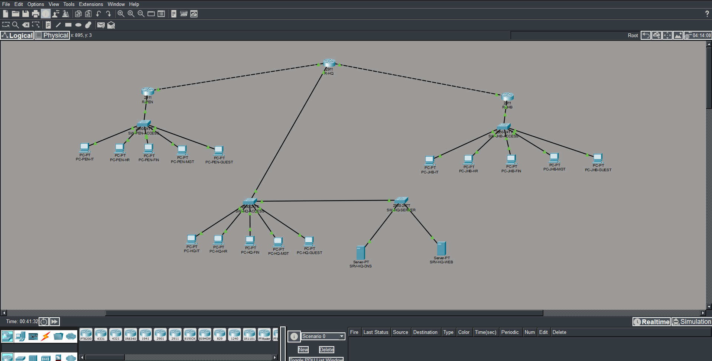

# Network Topology - Cisco Packet Tracer

This screenshot shows the final network I built in Cisco Packet Tracer.

The network connects three locations: Kuala Lumpur (HQ), Penang and Johor Bahru. It includes three routers, four switches, 15 PCs, and two servers.

The topology uses a hub-and-spoke design, with HQ connecting the two branches. Each location has separate departmental VLANs, while the HQ servers provide centralized DNS and intranet services.

For a more detailed view of the network design, see the [architecture documentation](../../docs/01_Architecture.md).
